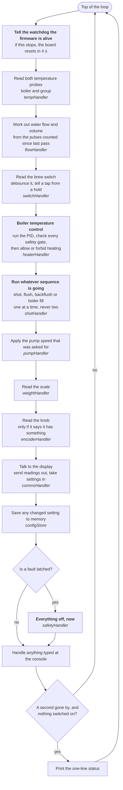
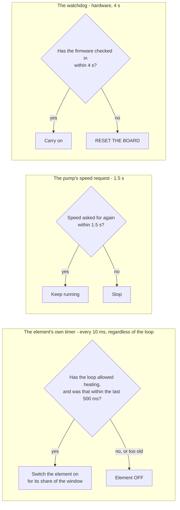

# Teensy controller: boot and main loop

Drawn from `src-controller/main.cpp`, not from memory. Control firmware only.
The display head gets one paragraph at the bottom and no diagram, on purpose.

Every box says what the machine is actually doing, with the source file in
brackets so you can go and read that part. **None of this is test code** - it
is the ordinary work the firmware does on every pass, forever.

---

## 1. Power on to idle

```mermaid
flowchart TD
    PWR([Power on]) --> T0

    T0["<b>Force every output off</b><br/>heater, pump, both valves, cold inlet<br/>first line of setup, before the serial port exists<br/><i>safetyHandler</i>"]
    T0 --> T1["Open the USB serial console<br/>wait up to 1.5 s for a PC to be attached"]
    T1 --> TUP{"Was a firmware update<br/>requested before the reboot?"}
    TUP -->|yes| TUPL["Sit in update mode<br/><b>never returns</b> - nothing below runs<br/><i>updateMode</i>"]
    TUP -->|no| T2["Print the banner, naming the pins<br/>it has just forced safe"]

    T2 --> T3["Set up the four relay outputs<br/><i>hardware/outputs</i>"]
    T3 --> T4["Start the I2C bus<br/><i>i2cHandler</i>"]
    T4 --> T5["Start both temperature probes<br/>boiler and group, and take one reading now<br/><i>tempHandler</i>"]
    T5 --> T6["Start both flow meter inputs<br/>attach the pulse counters, load calibration<br/><i>flowHandler</i>"]
    T6 --> T7["Set up the brew switch<br/><i>switchHandler</i>"]
    T7 --> T8["Set up the scale, two load cells<br/><i>weightHandler</i>"]
    T8 --> T9["Set up the pump, both bridge inputs low<br/>so it cannot creep<br/><i>pumpHandler</i>"]
    T9 --> T10["Start the heater's 10 ms timer<br/>the thing that will actually switch the element<br/><i>heaterHandler</i>"]
    T10 --> T11["Load the three drink profiles from memory<br/><i>shotHandler</i>"]
    T11 --> T12["Load saved settings from memory<br/><i>configStore</i>"]
    T12 --> T13["Open the serial link to the display<br/><i>commsHandler</i>"]
    T13 --> T14{"Does the knob answer<br/>on the I2C bus?"}
    T14 -->|yes| T14a["Light it in the selected drink's colour"]
    T14 -->|no| T14b["Carry on without it.<br/>Not fatal - the brew switch still works"]

    T14a --> SC
    T14b --> SC
    SC{"<b>START-UP CHECK</b><br/>only two things are tested"}
    SC --> SC1{"Did the last run end in a<br/>watchdog reset, meaning it hung?"}
    SC1 -->|yes| TF
    SC1 -->|no| SC2{"Does the boiler probe give<br/>a believable temperature?"}
    SC2 -->|no| TF
    SC2 -->|yes| TOK["Check passed"]
    TF["<b>FAULT LATCHED</b><br/>every output stays off until<br/>somebody clears it by hand"]

    TOK --> T15
    TF --> T15
    T15["Arm the watchdog<br/>it resets the board if the firmware hangs for 4 s"]
    T15 --> T16(["Running, waiting for you.<br/><b>Still cannot heat</b> - no water probe exists,<br/>so the dry-fire interlock refuses"])
```

### Worth noticing

**Outputs are forced off on the very first line**, before the serial port
exists. Nothing can print a banner about being safe before it is.

**A firmware update is checked for before any hardware is started.** If one
was requested, none of the rest of this runs.

**The start-up check tests two things only:** did the last run hang, and does
the boiler probe read something believable. Nothing checks the group probe,
the flow meter, the scale, the knob, the link to the display, or whether the
relay outputs actually work. **A dead group probe boots completely clean.**

**Reaching "running" is not the same as being able to heat.** The dry-fire
interlock has no water probe to ask, so it refuses. Correct, and not a boot
failure, but "booted fine" and "ready to heat" are two different states.

---

## 2. Main loop

The same list, in the same order, over and over. Worst single pass measured
is **0.2 ms**, so this runs thousands of times a second.

### What each one reads, decides and drives

| what it does | reads | decides | actually switches |
|---|---|---|---|
| Read the temperature probes | both probes over SPI | healthy or stale. **A stale reading counts as no reading**, never the last good value | nothing |
| Work out flow | the two pulse counters | millilitres and ml per second, per meter | nothing |
| Read the brew switch | the switch pin | debounce; tap versus hold | nothing |
| Boiler temperature control | boiler temp, target, every safety gate | how hard to heat, and **whether heating is allowed at all** | nothing directly - the 10 ms timer does the switching |
| Run the active sequence | switch taps, weight, volume, the clock | which sequence runs, which stage it is in, when to stop | **group valve, fill valve, cold inlet, pump speed** |
| Apply pump speed | the speed last asked for | has that request gone stale | **both pump bridge inputs** |
| Read the scale | the two load cells | grams, and whether to trust them | nothing |
| Read the knob | the knob, only when it flags activity | turns and presses | the knob's own light |
| Talk to the display | the serial link | what to send, what to accept | **nothing in the control path** |
| Save settings | which settings changed | when to actually write to memory | nothing |

### What that table shows

**Only two of the ten decide anything that moves.** Boiler control and the
sequence runner. Everything above them turns sensors into numbers; everything
below them carries out instructions. When something physically misbehaves,
those two are where to look first.

**Talking to the display drives nothing.** That is the design: unplug it and
the machine carries on.

**The fault check sits near the bottom**, after every handler has already
run. It is a backstop, not the mechanism - each handler refuses on its own
when a fault is latched.

---

## 3. What happens outside the loop

The loop does not switch the element. This is where the safety actually
lives, and it is the part you cannot see by reading the loop.

If the firmware hangs, the heater does not stay on. Permission to heat goes
stale within 500 ms and the timer switches the element off; the pump stops at
1.5 s; the watchdog resets the board at 4 s. **Staying on requires constantly
saying "still here". The safe state is what you get by doing nothing.**

**The one stop with no sensor behind it** is the shot's time limit. Weight and
volume both rely on a sensor that can fail silently and never report the
number being waited for. The clock cannot. Same reasoning for the flush cap,
the backflush timings, and the boiler fill's time cap.

---

## 4. The display, in one paragraph

The ESP32-S3 starts up on its own, brings up the screen, joins WiFi, serves
the web pages and sends its stored settings down to the Teensy. After that it
reads the Teensy's status and redraws. It switches nothing and holds no
safety; a touch is a request and the Teensy decides. If either board reboots,
the two notice and re-sync by themselves.

---

## Still to draw

Same treatment, if useful: the shot sequence and its stop conditions, the
chain of gates the heater has to pass, and how faults latch and clear.
